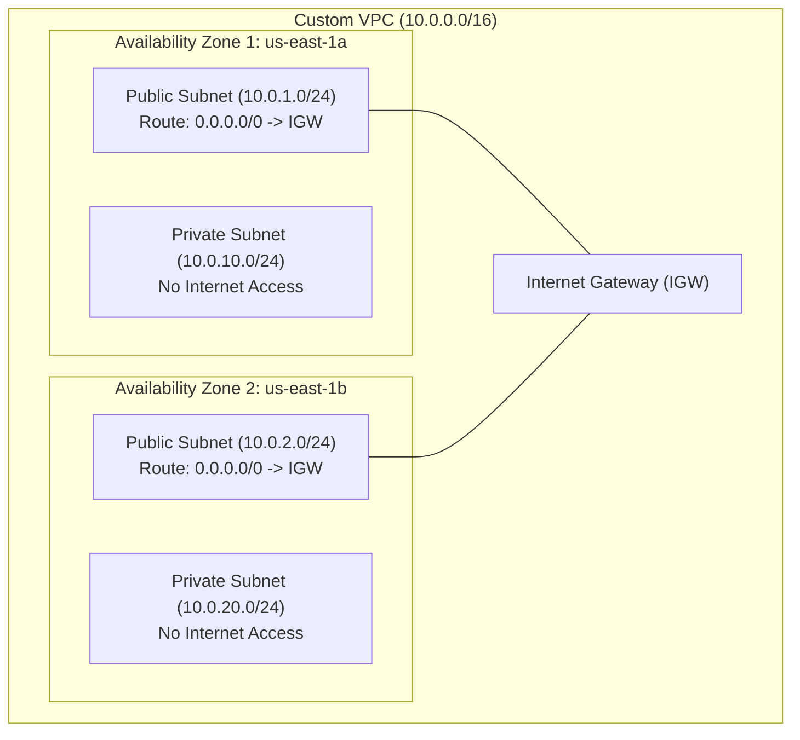

# 03 — AWS Core Cloud Networking & Custom Multi-AZ VPC

Amazon Virtual Private Cloud (VPC) provides logically isolated virtual networks in the AWS Cloud. Designing a secure VPC across multiple Availability Zones (Multi-AZ) is the foundational requirement for production Kubernetes, databases, and microservices.

---

## 1. Core Architecture & Components



### Components Breakdown:
1. **CIDR Block (`10.0.0.0/16`):** Provides 65,536 private IPv4 addresses for the entire VPC.
2. **Subnets (`/24`):** Subdivisions of the VPC allocated to specific AZs. Each `/24` yields 251 usable IPs (AWS reserves 5 IPs per subnet).
3. **Public Subnet:** Attached to a Route Table containing a route `0.0.0.0/0 -> igw-xxxx`. EC2 instances receive public IPs. Used for Load Balancers and public-facing bastion/demo hosts.
4. **Private Subnet:** Route Table does NOT route directly to the Internet Gateway. Used for Amazon RDS, internal microservices, and databases.
5. **Security Groups (SG) vs Network ACLs (NACL):**
   - **Security Groups:** Operate at the **network interface / instance level**. They are **stateful** (return traffic is automatically allowed).
   - **NACLs:** Operate at the **subnet level**. They are **stateless** (both inbound and outbound rules must be explicitly configured).

---

## 2. Step-by-Step AWS CLI VPC Creation

Execute these commands from your local workstation or terminal configured with AWS CLI:

```bash
# 💻 [Local Laptop Terminal] (with AWS CLI configured)

# 1. Create the Custom VPC with CIDR 10.0.0.0/16
VPC_ID=$(aws ec2 create-vpc \
  --cidr-block 10.0.0.0/16 \
  --tag-specifications 'ResourceType=vpc,Tags=[{Key=Name,Value=smartdoc-vpc}]' \
  --query 'Vpc.VpcId' --output text)
echo "Created VPC: $VPC_ID"

# Enable DNS Hostnames and DNS Resolution
aws ec2 modify-vpc-attribute --vpc-id $VPC_ID --enable-dns-hostnames "{\"Value\":true}"
aws ec2 modify-vpc-attribute --vpc-id $VPC_ID --enable-dns-support "{\"Value\":true}"

# 2. Create Internet Gateway (IGW) and attach to VPC
IGW_ID=$(aws ec2 create-internet-gateway \
  --tag-specifications 'ResourceType=internet-gateway,Tags=[{Key=Name,Value=smartdoc-igw}]' \
  --query 'InternetGateway.InternetGatewayId' --output text)
aws ec2 attach-internet-gateway --vpc-id $VPC_ID --internet-gateway-id $IGW_ID
echo "Attached IGW: $IGW_ID"

# 3. Create Public Subnet 1 (us-east-1a)
PUB_SUB1=$(aws ec2 create-subnet \
  --vpc-id $VPC_ID \
  --cidr-block 10.0.1.0/24 \
  --availability-zone us-east-1a \
  --tag-specifications 'ResourceType=subnet,Tags=[{Key=Name,Value=smartdoc-public-1a}]' \
  --query 'Subnet.SubnetId' --output text)

# 4. Create Public Subnet 2 (us-east-1b)
PUB_SUB2=$(aws ec2 create-subnet \
  --vpc-id $VPC_ID \
  --cidr-block 10.0.2.0/24 \
  --availability-zone us-east-1b \
  --tag-specifications 'ResourceType=subnet,Tags=[{Key=Name,Value=smartdoc-public-1b}]' \
  --query 'Subnet.SubnetId' --output text)

# Enable Auto-Assign Public IP for public subnets
aws ec2 modify-subnet-attribute --subnet-id $PUB_SUB1 --map-public-ip-on-launch
aws ec2 modify-subnet-attribute --subnet-id $PUB_SUB2 --map-public-ip-on-launch

# 5. Create Private Subnet 1 (us-east-1a) for RDS
PRIV_SUB1=$(aws ec2 create-subnet \
  --vpc-id $VPC_ID \
  --cidr-block 10.0.10.0/24 \
  --availability-zone us-east-1a \
  --tag-specifications 'ResourceType=subnet,Tags=[{Key=Name,Value=smartdoc-private-1a}]' \
  --query 'Subnet.SubnetId' --output text)

# 6. Create Private Subnet 2 (us-east-1b) for RDS
PRIV_SUB2=$(aws ec2 create-subnet \
  --vpc-id $VPC_ID \
  --cidr-block 10.0.20.0/24 \
  --availability-zone us-east-1b \
  --tag-specifications 'ResourceType=subnet,Tags=[{Key=Name,Value=smartdoc-private-1b}]' \
  --query 'Subnet.SubnetId' --output text)

# 7. Create Public Route Table and add default route to IGW
PUB_RT=$(aws ec2 create-route-table \
  --vpc-id $VPC_ID \
  --tag-specifications 'ResourceType=route-table,Tags=[{Key=Name,Value=smartdoc-public-rt}]' \
  --query 'RouteTable.RouteTableId' --output text)

aws ec2 create-route \
  --route-table-id $PUB_RT \
  --destination-cidr-block 0.0.0.0/0 \
  --gateway-id $IGW_ID

# Associate Public Subnets with Public Route Table
aws ec2 associate-route-table --subnet-id $PUB_SUB1 --route-table-id $PUB_RT
aws ec2 associate-route-table --subnet-id $PUB_SUB2 --route-table-id $PUB_RT

# 8. Create Private Route Table (No Internet Route)
PRIV_RT=$(aws ec2 create-route-table \
  --vpc-id $VPC_ID \
  --tag-specifications 'ResourceType=route-table,Tags=[{Key=Name,Value=smartdoc-private-rt}]' \
  --query 'RouteTable.RouteTableId' --output text)

# Associate Private Subnets with Private Route Table
aws ec2 associate-route-table --subnet-id $PRIV_SUB1 --route-table-id $PRIV_RT
aws ec2 associate-route-table --subnet-id $PRIV_SUB2 --route-table-id $PRIV_RT
```

---

## 3. Verification & Troubleshooting Commands

```bash
# 💻 [Local Laptop Terminal]
# List all VPCs in the region
aws ec2 describe-vpcs --output table

# Verify all subnets and their AZ mappings
aws ec2 describe-subnets \
  --filters "Name=vpc-id,Values=$VPC_ID" \
  --query "Subnets[*].[SubnetId,CidrBlock,AvailabilityZone,Tags[?Key=='Name'].Value|[0]]" \
  --output table

# Check routing rules for a specific route table
aws ec2 describe-route-tables --route-table-ids $PUB_RT --output table
```
