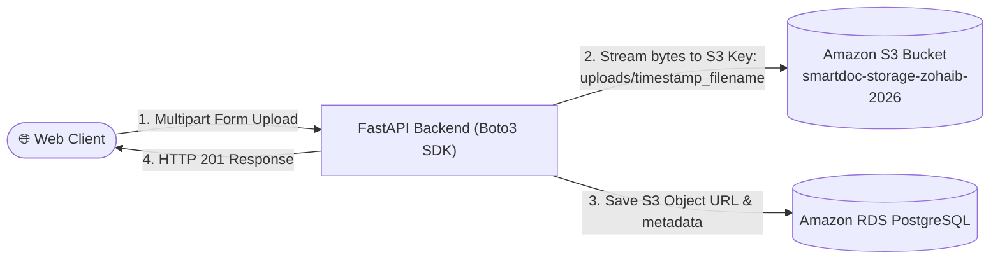

# 06 — Amazon S3 Object Storage & Direct Cloud Ingestion

Amazon Simple Storage Service (Amazon S3) is an industry-leading object storage service offering 99.999999999% (11 9s) of data durability. It is designed to store and protect any amount of unstructured data (PDFs, images, raw logs, machine learning models).

---

## 1. Core Architecture & Storage Model



### Key S3 Concepts:
- **Bucket:** Top-level container. Bucket names must be globally unique across all AWS accounts.
- **Key:** The unique identifier for an object within a bucket (e.g. `uploads/42954781420_elb_test.txt`).
- **Object Metadata:** System metadata (Content-Type, Size, ETag) and user-defined custom metadata.
- **Block Public Access:** Default security setting blocking public read/write permissions to prevent data breaches.

---

## 2. Bucket Creation & Security Hardening via AWS CLI

```bash
# 💻 [Local Laptop Terminal]
BUCKET_NAME="smartdoc-storage-zohaib-2026"
REGION="us-east-1"

# 1. Create the S3 Bucket
aws s3 mb s3://$BUCKET_NAME --region $REGION

# 2. Enforce Block Public Access (Zero-Trust)
aws s3api put-public-access-block \
  --bucket $BUCKET_NAME \
  --public-access-block-configuration '{
    "BlockPublicAcls": true,
    "IgnorePublicAcls": true,
    "BlockPublicPolicy": true,
    "RestrictPublicBuckets": true
  }'

# 3. Enable Default Server-Side Encryption (SSE-S3 / AES256)
aws s3api put-bucket-encryption \
  --bucket $BUCKET_NAME \
  --server-side-encryption-configuration '{
    "Rules": [
      {
        "ApplyServerSideEncryptionByDefault": {
          "SSEAlgorithm": "AES256"
        }
      }
    ]
  }'

# 4. Enable Bucket Versioning (Protects against accidental deletions)
aws s3api put-bucket-versioning \
  --bucket $BUCKET_NAME \
  --versioning-configuration Status=Enabled
```

---

## 3. S3 CLI Master Reference

```bash
# 💻 [Local Laptop Terminal] or ☁️ [Ubuntu EC2 Terminal]

# List all buckets in AWS account
aws s3 ls

# List files within a specific bucket prefix
aws s3 ls s3://$BUCKET_NAME/uploads/

# Upload a local file to S3
aws s3 cp document.pdf s3://$BUCKET_NAME/uploads/document.pdf

# Download an object from S3
aws s3 cp s3://$BUCKET_NAME/uploads/document.pdf ./downloaded.pdf

# Sync an entire local folder to S3 (only uploads changed files)
aws s3 sync ./assets s3://$BUCKET_NAME/assets/

# Generate a temporary pre-signed URL (valid for 15 minutes / 900 seconds)
aws s3 presign s3://$BUCKET_NAME/uploads/document.pdf --expires-in 900

# Delete an object
aws s3 rm s3://$BUCKET_NAME/uploads/document.pdf

# Empty an entire bucket
aws s3 rm s3://$BUCKET_NAME --recursive
```

---

## 4. Application Integration: Python Boto3 Streaming

In production microservices, avoid saving uploaded files to local container disk before uploading to S3. Instead, **stream the file directly from memory/buffer**:

```python
import boto3
import os
from fastapi import UploadFile, HTTPException

s3_client = boto3.client(
    "s3",
    region_name=os.getenv("AWS_REGION", "us-east-1")
)

BUCKET_NAME = os.getenv("S3_BUCKET_NAME", "smartdoc-storage-zohaib-2026")

async def upload_document_to_s3(file: UploadFile) -> str:
    object_key = f"uploads/{file.filename}"
    try:
        # Stream file directly to S3
        s3_client.upload_fileobj(
            file.file,
            BUCKET_NAME,
            object_key,
            ExtraArgs={"ContentType": file.content_type or "application/octet-stream"}
        )
        s3_url = f"https://{BUCKET_NAME}.s3.amazonaws.com/{object_key}"
        return s3_url
    except Exception as e:
        raise HTTPException(status_code=500, detail=f"S3 Upload failed: {str(e)}")
```

---

## 5. Least-Privilege IAM Policy

Attach this policy to the EC2 Instance Profile or EKS Pod Service Account (IRSA):

```json
{
  "Version": "2012-10-17",
  "Statement": [
    {
      "Effect": "Allow",
      "Action": [
        "s3:PutObject",
        "s3:GetObject",
        "s3:ListBucket"
      ],
      "Resource": [
        "arn:aws:s3:::smartdoc-storage-zohaib-2026",
        "arn:aws:s3:::smartdoc-storage-zohaib-2026/*"
      ]
    }
  ]
}
```
