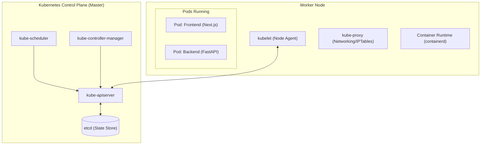

# 08 — Kubernetes Core Operations & kubectl Master Reference

Kubernetes (K8s) is an open-source container orchestration engine that automates application deployment, horizontal scaling, self-healing, and service discovery across a distributed cluster of nodes.

---

## 1. Core Architecture & Abstractions



### Core Resource Types:
1. **Pod:** The smallest deployable computing unit consisting of one or more co-located containers sharing network namespaces and storage volumes.
2. **Deployment:** Manages declarative desired state, replica counts, automated rollouts, and rollbacks via an underlying **ReplicaSet**.
3. **Service:** An abstraction defining a logical set of Pods and access policy:
   - **`ClusterIP` (Default):** Exposes service on an internal cluster-only IP. Resolvable via internal CoreDNS (e.g. `backend.smartdoc-ai.svc.cluster.local`).
   - **`NodePort`:** Exposes service on each worker node’s IP at a static port (`30000-32767`).
   - **`LoadBalancer`:** Integrates with the cloud provider (e.g. AWS) to provision a native external Load Balancer (ELB/NLB).
4. **ConfigMap & Secret:** Decouples configuration artifacts and sensitive credentials from container images.

---

## 2. Production Manifest Blueprint

### `backend.yaml` (Deployment + ClusterIP Service)
```yaml
apiVersion: apps/v1
kind: Deployment
metadata:
  name: backend
  namespace: smartdoc-ai
spec:
  replicas: 2
  strategy:
    type: RollingUpdate
    rollingUpdate:
      maxSurge: 1
      maxUnavailable: 0
  selector:
    matchLabels:
      app: backend
  template:
    metadata:
      labels:
        app: backend
    spec:
      containers:
        - name: backend
          image: 479537131188.dkr.ecr.us-east-1.amazonaws.com/smartdoc-backend:latest
          ports:
            - containerPort: 8000
          env:
            - name: DATABASE_URL
              valueFrom:
                secretKeyRef:
                  name: backend-secrets
                  key: database-url
          readinessProbe:
            httpGet:
              path: /api/v1/health
              port: 8000
            initialDelaySeconds: 5
            periodSeconds: 10
          livenessProbe:
            httpGet:
              path: /api/v1/health
              port: 8000
            initialDelaySeconds: 15
            periodSeconds: 20
          resources:
            requests:
              cpu: 100m
              memory: 128Mi
            limits:
              cpu: 500m
              memory: 512Mi
---
apiVersion: v1
kind: Service
metadata:
  name: backend
  namespace: smartdoc-ai
spec:
  type: ClusterIP
  selector:
    app: backend
  ports:
    - port: 8000
      targetPort: 8000
```

---

## 3. `kubectl` Command Master Reference

### A. Cluster State & Context
```bash
# ☸️ [Kubernetes / EKS Terminal]
# Check cluster control plane connectivity
kubectl cluster-info

# View active contexts and switch clusters
kubectl config get-contexts
kubectl config use-context <context-name>

# List all namespaces
kubectl get namespaces
```

---

### B. Pod & Resource Inspection
```bash
# ☸️ [Kubernetes / EKS Terminal]
# Get all pods across all namespaces
kubectl get pods -A

# Get pods with extended output (Node assignment, IP address)
kubectl get pods -n smartdoc-ai -o wide

# Describe a pod to inspect events, mount errors, and probes
kubectl describe pod <pod-name> -n smartdoc-ai

# View live container logs
kubectl logs -f <pod-name> -n smartdoc-ai

# View logs of a previously crashed container (-p)
kubectl logs -p <pod-name> -n smartdoc-ai

# View logs for all pods belonging to a label selector
kubectl logs -f -l app=backend -n smartdoc-ai --tail=50
```

---

### C. Live Debugging & Execution
```bash
# ☸️ [Kubernetes / EKS Terminal]
# Open an interactive shell inside a running pod
kubectl exec -it <pod-name> -n smartdoc-ai -- /bin/sh

# Forward a remote pod or service port to your local machine
kubectl port-forward svc/backend -n smartdoc-ai 8000:8000

# View real-time cluster events sorted by creation timestamp (Most valuable for debugging!)
kubectl get events -n smartdoc-ai --sort-by='.metadata.creationTimestamp'

# Check live CPU and Memory resource consumption
kubectl top nodes
kubectl top pods -n smartdoc-ai
```

---

### D. Deployments, Rollouts & Scaling
```bash
# ☸️ [Kubernetes / EKS Terminal]
# Apply manifests
kubectl apply -f k8s/

# Scale deployment replicas manually
kubectl scale deployment backend -n smartdoc-ai --replicas=4

# Check rollout progress
kubectl rollout status deployment/frontend -n smartdoc-ai

# Trigger a rolling restart of all pods in a deployment
kubectl rollout restart deployment/frontend -n smartdoc-ai

# View revision history and roll back to previous version
kubectl rollout history deployment/frontend -n smartdoc-ai
kubectl rollout undo deployment/frontend -n smartdoc-ai
```
