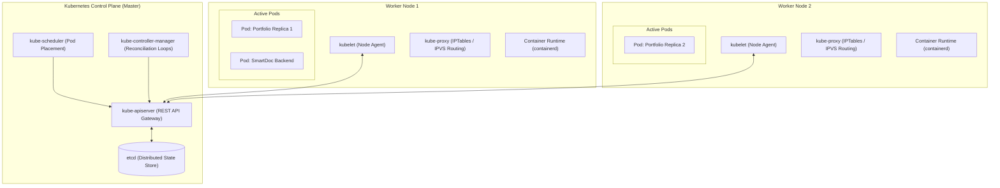

# 08 — Kubernetes Core Operations, Networking Architecture & kubectl Master Reference

Kubernetes (K8s) is an open-source container orchestration engine that automates application deployment, horizontal scaling, self-healing, and service discovery across a distributed cluster of nodes.

---

## 1. Core Architecture & Abstractions



### Core Resource Types:
1. **Pod:** The smallest atomic deployable computing unit consisting of one or more co-located containers sharing network namespaces (`localhost`) and storage volumes.
2. **Deployment:** Manages declarative desired state, replica counts, zero-downtime rolling updates, and rollbacks via an underlying **ReplicaSet**.
3. **Service:** An abstraction defining a logical set of Pods and access policy using label selectors (`app: portfolio`).
4. **ConfigMap & Secret:** Decouples configuration artifacts and sensitive credentials (API keys, DB URLs) from container images.
5. **Ingress:** An API object managing external access (HTTP/HTTPS) to services with host/path-based routing, SSL termination, and name-based virtual hosting.

---

## 2. Deep-Dive: Kubernetes Networking & The NodePort Mystery

### The Core Problem: Why Can't We Just Use Port 3002 Directly?
In Docker Compose on a single machine, mapping `ports: ["3002:80"]` binds directly to the host's network stack. In Kubernetes:
1. **Pod IPs are Ephemeral & Private:** Pods get private SDN overlay IPs (e.g., `10.244.0.15`). Outside routers and local browsers have **zero routes** to this virtual subnet.
2. **Pods Die and Respawn:** When a pod crashes or rescales, its IP changes completely. Hardcoding IP addresses in clients or Nginx configs is strictly forbidden.
3. **The Multi-Node Conflict Pitfall (`hostPort: 3002`):**
   - If you configure a Pod with `hostPort: 3002` and request `replicas: 2`:
   - Replica 1 schedules onto Node 1 and binds port `3002`.
   - If Replica 2 attempts to schedule onto Node 1, it crashes with:
     `FailedScheduling: 0/1 nodes are available: 1 node(s) didn't have free ports for the requested pod ports.`
   - **Result:** You break Kubernetes auto-scheduling, elasticity, and high availability!

---

### Service Types Compared:

| Service Type | Scope / Access Level | Port Range | Real-World Production Use Case |
| :--- | :--- | :--- | :--- |
| **`ClusterIP`** *(Default)* | **Cluster-Internal Only** | Any (e.g. 80, 8000, 5432) | Private databases (Postgres/Mongo) and internal microservices. Accessible only via CoreDNS (e.g. `backend.prod.svc.cluster.local`). |
| **`NodePort`** | **Cluster Nodes External IP** | **`30000 - 32767`** | Bare-metal clusters, On-Premise data centers, and local Minikube testing without cloud load balancers. |
| **`LoadBalancer`** | **Public Internet / Cloud** | Standard (80, 443) | Cloud-native production (AWS EKS, GCP GKE). Spawns an AWS ALB/NLB with a public IP/DNS. |
| **`ExternalName`** | **External DNS Mapping** | N/A | Maps a cluster service to an external CNAME (e.g., an external RDS endpoint). |

---

### Why is NodePort a 5-Digit Port (`30000 - 32767`)?
- **Host Port Conflict Prevention:**
  - Ports `0 - 1023`: System/Root reserved privileged ports (SSH 22, HTTP 80, DNS 53).
  - Ports `1024 - 29999`: Host OS services and local processes (Postgres 5432, Docker 2375, Node 3000).
- **Cluster-Wide Binding:**
  When you declare `nodePort: 30002`, Kubernetes instructs `kube-proxy` on **EVERY worker node in the entire cluster** to open port `30002`. Hitting `<Node-1-IP>:30002`, `<Node-2-IP>:30002`, or `<Node-50-IP>:30002` routes seamlessly to healthy pods via iptables/IPVS.

---

### The Ingress Paradox: "If Nginx listens on 80/443, why do we need NodePort?"
```text
[External Users]
       │ (HTTP:80 / HTTPS:443)
       ▼
┌───────────────────────────────────────────────┐
│ Cloud Load Balancer (AWS ALB / NLB)           │  <-- Cloud Public IP
└──────────────────────┬────────────────────────┘
                       │ (Routes to NodePort 30080 or Direct Pod ENI)
                       ▼
┌───────────────────────────────────────────────┐
│ Nginx Ingress Controller (Running as a POD!)  │  <-- Layer 7 Routing
└──────────────────────┬────────────────────────┘
                       │ (ClusterIP Internal Routing via CoreDNS)
         ┌─────────────┴─────────────┐
         ▼                           ▼
[Portfolio Pod (Port 80)]   [API Backend Pod (Port 8000)]
```
- **The Catch:** The Nginx Ingress Controller is **itself a Pod running inside the cluster**!
- To allow external internet traffic into the Ingress Pod, the cluster must expose the Ingress Controller via a **Cloud LoadBalancer** or a **NodePort**.
- Once traffic reaches the Ingress Controller Pod, it routes traffic directly to application pods via **`ClusterIP`** without needing NodePorts on every app!

---

## 3. Minikube SRE Guide & Zero-Internet Image Streaming

### The Docker Hub Registry Hang Trap
When executing `minikube image load <image-name>:<tag>`, Minikube checks for slashes (`/`) in the image name (e.g., `zohaibhasan/3d-portfolio:latest`).
- Minikube attempts to contact `index.docker.io/zohaibhasan/3d-portfolio` over the internet before loading.
- If your ISP or local network has blocked or timed out connections to Docker Hub (`registry-1.docker.io:443`), `minikube image load` **hangs indefinitely**!

```text
# Log trace showing the hang:
I1027 15:57:57 image.go:145] retrieving image: zohaibhasan/3d-portfolio:latest
I1027 15:57:57 image.go:151] checking repository: index.docker.io/zohaibhasan/3d-portfolio
... (hangs waiting on network socket timeout)
```

### Pro-DevOps Fix: Direct containerd Pipe Stream (0% Internet, 100% Local)
Minikube runs as a Docker container with `containerd` inside (`k8s.io` namespace). Stream the image archive directly from your host Docker daemon to Minikube's `ctr` socket:

```bash
# ☸️ [Terminal: Zero-Network Fast Import (< 2 seconds)]
docker save zohaibhasan/3d-portfolio:latest | docker exec -i minikube ctr -n k8s.io images import -

# If using local tag:
docker save zohaib-portfolio:v1 | docker exec -i minikube ctr -n k8s.io images import -
```

### Verification in Kubernetes Runtime:
Verify that the image is officially recognized by the Kubernetes CRI (`crictl`):
```bash
docker exec minikube crictl images | grep portfolio
```

### Accessing Services in Minikube:
1. **Minikube NodePort Direct URL (Permanent while cluster is running):**
   ```bash
   minikube service portfolio-service --url
   # Output: http://192.168.49.2:30002
   ```
2. **Port-Forward (Temporary SRE Debugging Tool):**
   ```bash
   kubectl port-forward svc/portfolio-service 3002:80
   # Closes when terminal terminates (Ctrl+C)
   ```
3. **Minikube Tunnel (For `type: LoadBalancer`):**
   ```bash
   # Assigns real host-routable external IPs to LoadBalancer services
   minikube tunnel
   ```

---

## 4. Production Manifest Blueprints

### Blueprint A: Zohaib Hassan 3D Cloud Portfolio (`k8s/`)

#### 1. `k8s/deployment.yaml`
```yaml
apiVersion: apps/v1
kind: Deployment
metadata:
  name: portfolio-deployment
  labels:
    app: portfolio
    environment: production
spec:
  # 2 Replicas for High Availability & Load Balancing
  replicas: 2
  selector:
    matchLabels:
      app: portfolio
  template:
    metadata:
      labels:
        app: portfolio
    spec:
      containers:
        - name: portfolio-app
          image: zohaibhasan/3d-portfolio:latest
          # Crucial: Uses local image loaded into containerd without contacting Docker Hub
          imagePullPolicy: IfNotPresent
          ports:
            - containerPort: 80
              name: http
          resources:
            requests:
              cpu: 50m
              memory: 64Mi
            limits:
              cpu: 250m
              memory: 256Mi
          # Kubernetes checks if the container is healthy
          livenessProbe:
            httpGet:
              path: /health
              port: 80
            initialDelaySeconds: 5
            periodSeconds: 10
            timeoutSeconds: 2
            failureThreshold: 3
          # Kubernetes only routes traffic when readiness passes
          readinessProbe:
            httpGet:
              path: /health
              port: 80
            initialDelaySeconds: 2
            periodSeconds: 5
            timeoutSeconds: 2
            failureThreshold: 2
```

#### 2. `k8s/service.yaml`
```yaml
apiVersion: v1
kind: Service
metadata:
  name: portfolio-service
  labels:
    app: portfolio
spec:
  type: NodePort
  selector:
    app: portfolio
  ports:
    - name: http
      port: 80
      targetPort: 80
      nodePort: 30002
```

---

### Blueprint B: SmartDoc AI Microservice (`backend.yaml` - ClusterIP)

```yaml
apiVersion: apps/v1
kind: Deployment
metadata:
  name: backend
  namespace: smartdoc-ai
spec:
  replicas: 2
  strategy:
    type: RollingUpdate
    rollingUpdate:
      maxSurge: 1
      maxUnavailable: 0
  selector:
    matchLabels:
      app: backend
  template:
    metadata:
      labels:
        app: backend
    spec:
      containers:
        - name: backend
          image: 479537131188.dkr.ecr.us-east-1.amazonaws.com/smartdoc-backend:latest
          ports:
            - containerPort: 8000
          env:
            - name: DATABASE_URL
              valueFrom:
                secretKeyRef:
                  name: backend-secrets
                  key: database-url
          readinessProbe:
            httpGet:
              path: /api/v1/health
              port: 8000
            initialDelaySeconds: 5
            periodSeconds: 10
          livenessProbe:
            httpGet:
              path: /api/v1/health
              port: 8000
            initialDelaySeconds: 15
            periodSeconds: 20
          resources:
            requests:
              cpu: 100m
              memory: 128Mi
            limits:
              cpu: 500m
              memory: 512Mi
---
apiVersion: v1
kind: Service
metadata:
  name: backend
  namespace: smartdoc-ai
spec:
  type: ClusterIP
  selector:
    app: backend
  ports:
    - port: 8000
      targetPort: 8000
```

---

## 5. `kubectl` Command Master Reference

### A. Cluster State & Context
```bash
# ☸️ [Kubernetes / EKS Terminal]
# Check cluster control plane connectivity
kubectl cluster-info

# View active contexts and switch clusters
kubectl config get-contexts
kubectl config use-context <context-name>

# List all namespaces
kubectl get namespaces
```

---

### B. Pod & Resource Inspection
```bash
# ☸️ [Kubernetes / EKS Terminal]
# Get all pods across all namespaces
kubectl get pods -A

# Get pods with extended output (Node assignment, IP address)
kubectl get pods -l app=portfolio -o wide

# Describe a pod to inspect events, mount errors, and probes
kubectl describe pod <pod-name>

# View live container logs
kubectl logs -f <pod-name>

# View logs of a previously crashed container (-p)
kubectl logs -p <pod-name>

# View combined logs for all pods belonging to a label selector
kubectl logs -f -l app=portfolio --tail=50
```

---

### C. Live Debugging & Execution
```bash
# ☸️ [Kubernetes / EKS Terminal]
# Open an interactive shell inside a running pod
kubectl exec -it <pod-name> -- /bin/sh

# Forward a remote pod or service port to your local machine (Temporary SRE Tool)
kubectl port-forward svc/portfolio-service 3002:80

# View real-time cluster events sorted by creation timestamp (Most valuable for debugging!)
kubectl get events --sort-by='.metadata.creationTimestamp'

# Check live CPU and Memory resource consumption (Requires metrics-server)
kubectl top nodes
kubectl top pods
```

---

### D. Deployments, Rollouts, Scaling & Self-Healing Testing
```bash
# ☸️ [Kubernetes / EKS Terminal]
# Apply all manifests in a directory
kubectl apply -f k8s/

# Scale deployment replicas manually
kubectl scale deployment portfolio-deployment --replicas=4

# Test Kubernetes Self-Healing (Delete a pod and watch K8s instantly recreate it)
kubectl delete pod <pod-name>
kubectl get pods -l app=portfolio -w

# Check rollout progress
kubectl rollout status deployment/portfolio-deployment

# Trigger a rolling restart of all pods in a deployment
kubectl rollout restart deployment/portfolio-deployment

# View revision history and roll back to previous version
kubectl rollout history deployment/portfolio-deployment
kubectl rollout undo deployment/portfolio-deployment
```
