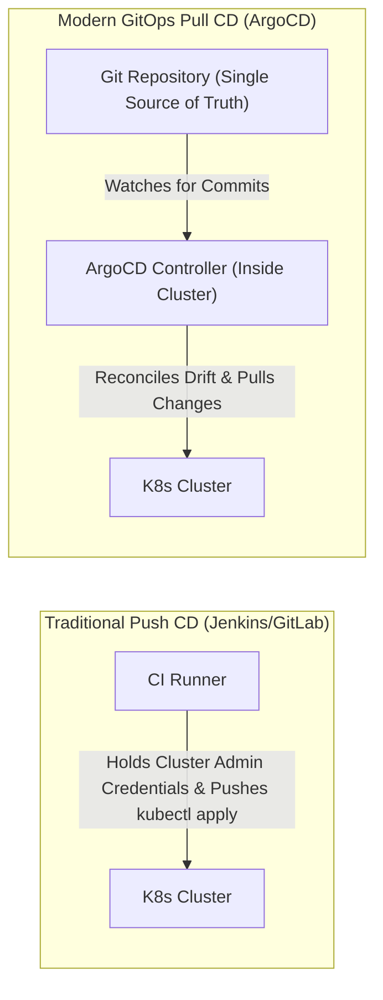

# 10 — GitOps Continuous Delivery with ArgoCD

GitOps is an operational framework that takes DevOps best practices used for application development (version control, collaboration, compliance, and CI/CD) and applies them to infrastructure automation.

---

## 1. What is GitOps? (Push vs Pull CD)



### Advantages of Pull-based GitOps:
1. **Zero External Access Credentials:** The CI system never receives `cluster-admin` credentials.
2. **Automated Drift Detection & Self-Healing:** If someone manually modifies a pod or deployment via `kubectl edit`, ArgoCD automatically reverts the cluster to match Git.
3. **Auditability & Rollback:** Every cluster change is recorded as a `git commit`. Rolling back is as simple as `git revert`.

---

## 2. Installing ArgoCD on Kubernetes

```bash
# ☸️ [Kubernetes / EKS Terminal]
# 1. Create dedicated argocd namespace
kubectl create namespace argocd

# 2. Apply official ArgoCD installation manifests
kubectl apply -n argocd -f https://raw.githubusercontent.com/argoproj/argo-cd/stable/manifests/install.yaml

# 3. Wait for all ArgoCD components to become Running
kubectl wait --for=condition=available deployment/argocd-server -n argocd --timeout=300s
```

---

## 3. Accessing the ArgoCD Dashboard

```bash
# ☸️ [Kubernetes / EKS Terminal]
# 1. Retrieve the default initial admin password (decoded from base64)
kubectl -n argocd get secret argocd-initial-admin-secret \
  -o jsonpath="{.data.password}" | base64 -d
echo ""

# 2. Port-forward the ArgoCD UI to localhost port 8081
kubectl port-forward svc/argocd-server -n argocd 8081:443
```

Open your browser at **`https://localhost:8081`** (Username: `admin`, Password: output from command above).

---

## 4. Declarative GitOps Application Manifest

Instead of clicking through the UI, define your application declaratively using the ArgoCD `Application` Custom Resource Definition (CRD):

### `argocd-application.yaml`
```yaml
apiVersion: argoproj.io/v1alpha1
kind: Application
metadata:
  name: smartdoc-ai
  namespace: argocd
  finalizers:
    - resources-finalizer.argocd.argoproj.io
spec:
  project: default
  source:
    repoURL: 'https://github.com/ZohaibHasan2280168/smartdoc-ai.git'
    targetRevision: main
    path: k8s
  destination:
    server: 'https://kubernetes.default.svc'
    namespace: smartdoc-ai
  syncPolicy:
    automated:
      prune: true
      selfHeal: true
    syncOptions:
      - CreateNamespace=true
```

```bash
# ☸️ [Kubernetes / EKS Terminal]
# Apply the GitOps application definition
kubectl apply -f argocd-application.yaml
```

---

## 5. ArgoCD Health & Sync Status Reference

| Status | Icon | Meaning | Action Needed |
| :--- | :--- | :--- | :--- |
| **Synced** | 🟢 Check | Live cluster matches Git repository commit. | None. State is healthy. |
| **OutOfSync** | 🟡 Arrow | Git repository has newer commits than cluster. | Trigger Sync or wait for auto-sync. |
| **Healthy** | 💚 Heart | All pods, services, and probes are 100% operational. | Production ready. |
| **Degraded** | 🔴 Heart | Pods in `CrashLoopBackOff`, failed probes, or missing volumes. | Check `kubectl logs` and `describe pod`. |
| **Progressing**| ⏳ Clock | Rolling update in progress; pods being pulled/swapped. | Wait for rolling deployment. |

---

## 6. Real Production Challenge: Split-Horizon DNS for ArgoCD

When testing ArgoCD locally (e.g. Minikube) while connecting to private cloud resources (e.g. AWS RDS in private subnets):
- Local backend pods cannot resolve private AWS Route53 records over public internet.
- **Fix:** Patch the local cluster's CoreDNS ConfigMap to stub the private RDS hostname to a local host IP, keeping ArgoCD permanently **Healthy 💚 / Synced**.
