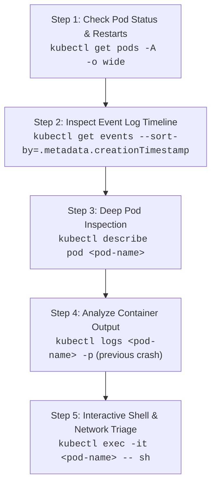

# 12 — Production Troubleshooting & War Stories

In production cloud and Kubernetes operations, issues rarely occur in isolation. This chapter documents real-world debugging workflows, failure signatures, and battle-tested war stories to help you troubleshoot incidents and ace technical interviews.

---

## 1. The Systematic 5-Step Kubernetes Debugging Framework

When a pod or service is failing, follow this disciplined triage sequence:



---

## 2. Production War Stories & Case Studies

### 💥 Case Study 1: The Next.js Standalone Rewrite Burn-in Trap
- **The Symptom:** Frontend pod is running (1/1 Running, 0 restarts), but browser displays:
  ```text
  Health probe failed: JSON.parse: unexpected character at line 1 column 1. Is backend running on ?
  ```
- **Root Cause:** Next.js standalone mode evaluates `next.config.js` rewrites at `docker build` time and hardcodes the destination into `.next/routes-manifest.json` (`http://localhost:8000/api/:path*`). When deployed on EKS, frontend pods proxy `/api/*` to their own container's `localhost:8000` where no backend runs, returning an HTML 500 error page that breaks JSON parsing.
- **The Fix:** Inject a container startup command in `k8s/frontend.yaml` to dynamically rewrite the routes manifest to the internal Kubernetes service DNS before `server.js` starts:
  ```bash
  sed -i 's|http://localhost:8000|http://backend.smartdoc-ai.svc.cluster.local:8000|g' .next/routes-manifest.json && exec node server.js
  ```

---

### 💥 Case Study 2: The Shallow Probe Zero-Downtime Illusion
- **The Symptom:** During rolling update, traffic experiences a 30-second outage despite `maxUnavailable: 0`.
- **Root Cause:** The frontend readiness probe was shallow:
  ```yaml
  readinessProbe:
    httpGet:
      path: /
      port: 3000
  ```
  Next.js returns HTTP 200 for the static HTML page even if its backend proxy is failing. Kubernetes prematurely marked the new pods "Ready" and terminated older functional pods before backend communication was established.
- **The Fix:** Configure deep readiness probes checking live microservice health (`/api/v1/health`) and set proper `initialDelaySeconds: 10` and `periodSeconds: 5`.

---

### 💥 Case Study 3: GitHub Push Protection Secret Block
- **The Symptom:** `git push origin main` fails with:
  ```text
  remote: error: GH013: Repository rule violations found for refs/heads/main.
  remote: - GITHUB PUSH PROTECTION
  remote:   AWS Access Key ID detected.
  ```
- **Root Cause:** A developer accidentally committed plaintext AWS credentials in `k8s/backend.yaml`.
- **The Fix:** Sanitize manifests immediately, store secrets in GitHub Secrets or AWS Secrets Manager, and revoke exposed keys in AWS IAM.

---

### 💥 Case Study 4: Orphaned AWS Load Balancer Preventing VPC Deletion
- **The Symptom:** Running `eksctl delete cluster` or `aws ec2 delete-vpc` hangs with:
  ```text
  DependencyViolation: The vpc 'vpc-xxxx' has dependencies and cannot be deleted.
  ```
- **Root Cause:** The Kubernetes Service `type: LoadBalancer` created an AWS Classic ELB with Network Interfaces (ENIs) inside the VPC subnets. Deleting the cluster before the Service leaves the ELB orphaned.
- **The Fix:** Always delete the Kubernetes LoadBalancer Service first (`kubectl delete svc frontend -n smartdoc-ai`) to let AWS de-provision the ELB cleanly before deleting the cluster.

---

### 💥 Case Study 5: Kernel OOM-Killer on Low-Memory Cloud VMs
- **The Symptom:** On a `t2.micro` (1GB RAM) EC2 server, running `docker compose up --build` or `npm run build` abruptly freezes the SSH terminal and drops the instance.
- **Root Cause:** Node.js memory spikes exhaust the 1GB RAM, triggering Linux kernel Out-Of-Memory (OOM) killer to terminate `systemd`, `dockerd`, or `sshd`.
- **The Fix:** Configure a 2GB persistent Linux Swap file on the host (`/swapfile`), giving the OS disk-backed memory headroom for compile-time spikes.

---

### 💥 Case Study 6: The 12-Hour AWS ECR Token Expiration & Broken CD Loop
- **The Symptom:** A GitHub Actions CI/CD pipeline pushes new images to AWS ECR, but the EC2 host containers run outdated images (e.g. 8 days old), and running `docker pull` on EC2 outputs:
  ```text
  Error response from daemon: error from registry: Your authorization token has expired
  ```
- **Root Cause:** AWS ECR authentication tokens expire every 12 hours. If an EC2 host lacks the AWS CLI or IAM instance profile credentials, it cannot refresh its own Docker login. Furthermore, CI builds pushed to ECR without an automated webhook/SSH trigger to notify EC2 to pull the new image.
- **The Fix:** Implement an automated Continuous Deployment (CD) job in GitHub Actions. The GitHub runner (which has AWS credentials) fetches a fresh token via `aws ecr get-login-password`, opens an SSH pipe into EC2, authenticates Docker with `echo "$TOKEN" | docker login --username AWS --password-stdin <ECR_REGISTRY>`, pulls the immutable version tag, updates `docker-compose.yml`, and restarts the container:
  ```bash
  ssh -o StrictHostKeyChecking=no -i ~/.ssh/id_rsa user@ec2-host << EOF
    echo "${TOKEN}" | docker login --username AWS --password-stdin ${REGISTRY}
    docker pull ${TARGET_IMAGE}
    sed -i -E 's|image: .*myapp:.*|image: '"${TARGET_IMAGE}"'|g' ~/docker-compose.yml
    docker compose up -d myapp
  EOF
  ```

---

### 💥 Case Study 7: The Multi-Subdomain CORS Trap & Regex Specificity
- **The Symptom:** Frontend works on production (`admin.systemic.pk`), but on staging (`admin.staging.systemic.pk`) or multi-tenant staging (`client.staging.systemic.pk`), all API calls fail with:
  ```text
  Cross-Origin Request Blocked: The Same Origin Policy disallows reading the remote resource.
  (Reason: CORS header 'Access-Control-Allow-Origin' missing). Status code: 200 / (null).
  ```
- **Root Cause:** The backend CORS middleware employed a strict single-subdomain regular expression:
  ```javascript
  const pattern = new RegExp(`^https://([a-z0-9-]+\\.)?${escapedRoot}$`, "i");
  ```
  While `admin.systemic.pk` matched (1 subdomain), `admin.staging.systemic.pk` contains 2 subdomains (`admin` and `staging`), causing the regex to reject the origin and omit the `Access-Control-Allow-Origin` header on preflight `OPTIONS` requests.
- **The Fix:** Upgrade the CORS regex to match multi-level nesting using the Kleene star `*`:
  ```javascript
  if (/^https?:\/\/([a-z0-9-]+\.)*(systemic\.pk|veave\.pk)(:\d+)?$/i.test(normalized)) {
    return true;
  }
  ```
  Diagnose immediately using curl preflight simulation:
  ```bash
  curl -si -X OPTIONS "https://api.systemic.pk/api/auth/login" \
    -H "Origin: https://admin.staging.systemic.pk" \
    -H "Access-Control-Request-Method: POST" | grep -i "access-control-allow-origin"
  ```

---

### 💥 Case Study 8: CrashLoop in Docker Containers Due to Missing Storage/Cloud Secrets
- **The Symptom:** Newly pulled container fails to stay running, entering status:
  ```text
  Restarting (1) 2 seconds ago
  ```
- **Root Cause:** Application initialization code added strict validation for new cloud services (e.g. Cloudflare R2 / AWS S3 buckets), but the host's `.env` file was not updated with the newly required keys (`R2_ACCOUNT_ID`, `R2_ACCESS_KEY_ID`, etc.).
- **The Fix:** Inspect the crash reason with `docker logs --tail 50 <container_name>`, append missing variables to `~/backend.env`, and restart with `docker compose up -d <service>`.

---

### 💥 Case Study 9: The 220MB Artifact Pipeline Choke
- **The Symptom:** CI/CD builds hang for 15+ minutes on `actions/upload-artifact@v4` or fail due to network socket timeouts.
- **Root Cause:** Splitting CI into Job 1 (`build`) and Job 2 (`docker package`) required uploading a 240MB Vite/Next.js output bundle containing 3D models and videos over the GitHub Actions artifact storage API, only to download it again in Job 2.
- **The Fix:** Consolidate into a unified single-runner build & push job. The local `build/` artifact is copied directly into the Docker image via local Dockerfile context without intermediate network hops, reducing pipeline duration from 18 minutes to under 2 minutes.

---

## 3. Production Docker, Compose & Host Inspection Toolkit

### A. Deep Container & Image Inspection
```bash
# 1. Format-specific inspection to verify active image tag
docker inspect <container_name> --format '{{.Config.Image}}'

# 2. Check healthcheck status and failure logs
docker inspect <container_name> --format '{{json .State.Health}}' | jq .

# 3. View container environment variables (excluding system defaults)
docker inspect <container_name> --format '{{range .Config.Env}}{{println .}}{{end}}'

# 4. Check container IP address on internal bridge network
docker inspect <container_name> --format '{{range .NetworkSettings.Networks}}{{.IPAddress}}{{end}}'

# 5. Check Docker Compose project label
docker inspect <container_name> --format '{{index .Config.Labels "com.docker.compose.project"}}'
```

### B. Live Container Hot-Patching & Maintenance
```bash
# 1. Copy updated configuration directly into running container (Zero-rebuild hotpatch)
docker cp /path/to/updated-file.js <container_name>:/app/config/file.js

# 2. Restart container to load new configuration
docker restart <container_name>

# 3. Commit running container into a tagged local image (Preserve hotpatch)
docker commit <container_name> myapp:hotfix-v1

# 4. Clean up dangling images and stopped containers to free disk space
docker system prune -f
```

### C. Remote SSH Debugging Idioms
```bash
# 1. Non-interactive remote command execution with clean output
ssh -o StrictHostKeyChecking=no -i <key.pem> ubuntu@<host> "docker ps && docker images"

# 2. Executing multi-line bash scripts remotely via Heredoc
ssh -o StrictHostKeyChecking=no -i <key.pem> ubuntu@<host> bash << 'EOF'
  set -e
  docker pull myregistry/myapp:v1.2.3
  docker compose -f ~/docker-compose.yml up -d
  docker system prune -f
EOF
```

---

## 4. Quick Triage Reference Table

| Symptom / Error | Typical Cause | Instant Command to Diagnose |
| :--- | :--- | :--- |
| `CrashLoopBackOff` | Application crash on boot, missing env var, DB connection fail | `kubectl logs <pod> --previous` |
| `Restarting (1)` | Missing environment variable, uncaught startup exception | `docker logs --tail 50 <container_name>` |
| `ImagePullBackOff` | Wrong image tag, typo in ECR URL, expired IAM permissions | `kubectl describe pod <pod>` |
| `Token has expired` | AWS ECR 12-hour authorization token timed out | `aws ecr get-login-password \| docker login --password-stdin` |
| `CORS header missing` | Origin regex mismatch, multi-level subdomain rejected | `curl -si -X OPTIONS "<API>" -H "Origin: <FRONTEND>"` |
| `Pending` Pod | Insufficient CPU/RAM on worker nodes, node unschedulable | `kubectl describe pod <pod> \| grep -A 5 Events` |
| `502 Bad Gateway` | Reverse proxy (Nginx/ELB) cannot reach container port | `curl -I localhost:3000` on host |
| `Connection Refused: 5432` | Security Group not chained, RDS in wrong subnet | `nc -zv <rds-host> 5432` from EC2 |
| `Disk Full / No space left` | Dangling Docker images or heavy journal logs | `docker system prune -af && sudo journalctl --vacuum-time=2d` |
