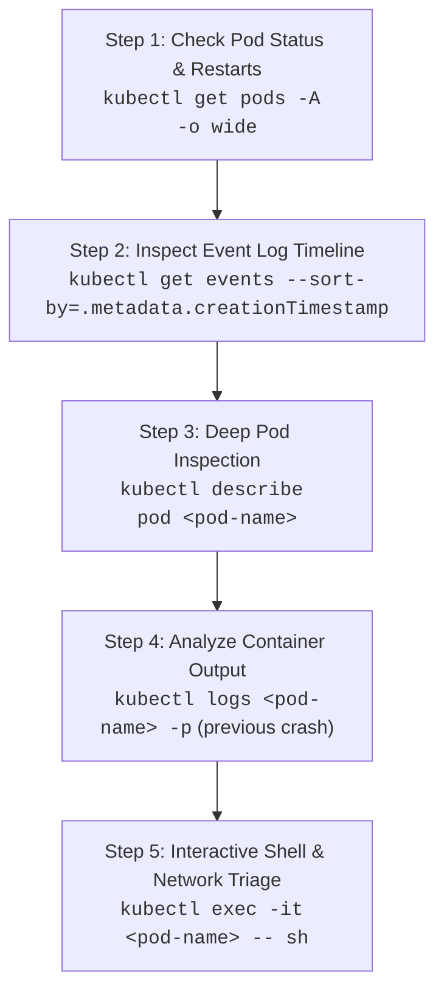

# 12 — Production Troubleshooting & War Stories

In production cloud and Kubernetes operations, issues rarely occur in isolation. This chapter documents real-world debugging workflows, failure signatures, and battle-tested war stories to help you troubleshoot incidents and ace technical interviews.

---

## 1. The Systematic 5-Step Kubernetes Debugging Framework

When a pod or service is failing, follow this disciplined triage sequence:



---

## 2. Production War Stories & Case Studies

### 💥 Case Study 1: The Next.js Standalone Rewrite Burn-in Trap
- **The Symptom:** Frontend pod is running (1/1 Running, 0 restarts), but browser displays:
  ```text
  Health probe failed: JSON.parse: unexpected character at line 1 column 1. Is backend running on ?
  ```
- **Root Cause:** Next.js standalone mode evaluates `next.config.js` rewrites at `docker build` time and hardcodes the destination into `.next/routes-manifest.json` (`http://localhost:8000/api/:path*`). When deployed on EKS, frontend pods proxy `/api/*` to their own container's `localhost:8000` where no backend runs, returning an HTML 500 error page that breaks JSON parsing.
- **The Fix:** Inject a container startup command in `k8s/frontend.yaml` to dynamically rewrite the routes manifest to the internal Kubernetes service DNS before `server.js` starts:
  ```bash
  sed -i 's|http://localhost:8000|http://backend.smartdoc-ai.svc.cluster.local:8000|g' .next/routes-manifest.json && exec node server.js
  ```

---

### 💥 Case Study 2: The Shallow Probe Zero-Downtime Illusion
- **The Symptom:** During rolling update, traffic experiences a 30-second outage despite `maxUnavailable: 0`.
- **Root Cause:** The frontend readiness probe was shallow:
  ```yaml
  readinessProbe:
    httpGet:
      path: /
      port: 3000
  ```
  Next.js returns HTTP 200 for the static HTML page even if its backend proxy is failing. Kubernetes prematurely marked the new pods "Ready" and terminated older functional pods before backend communication was established.
- **The Fix:** Configure deep readiness probes checking live microservice health (`/api/v1/health`) and set proper `initialDelaySeconds: 10` and `periodSeconds: 5`.

---

### 💥 Case Study 3: GitHub Push Protection Secret Block
- **The Symptom:** `git push origin main` fails with:
  ```text
  remote: error: GH013: Repository rule violations found for refs/heads/main.
  remote: - GITHUB PUSH PROTECTION
  remote:   AWS Access Key ID detected.
  ```
- **Root Cause:** A developer accidentally committed plaintext AWS credentials in `k8s/backend.yaml`.
- **The Fix:** Sanitize manifests immediately, store secrets in GitHub Secrets or AWS Secrets Manager, and revoke exposed keys in AWS IAM.

---

### 💥 Case Study 4: Orphaned AWS Load Balancer Preventing VPC Deletion
- **The Symptom:** Running `eksctl delete cluster` or `aws ec2 delete-vpc` hangs with:
  ```text
  DependencyViolation: The vpc 'vpc-xxxx' has dependencies and cannot be deleted.
  ```
- **Root Cause:** The Kubernetes Service `type: LoadBalancer` created an AWS Classic ELB with Network Interfaces (ENIs) inside the VPC subnets. Deleting the cluster before the Service leaves the ELB orphaned.
- **The Fix:** Always delete the Kubernetes LoadBalancer Service first (`kubectl delete svc frontend -n smartdoc-ai`) to let AWS de-provision the ELB cleanly before deleting the cluster.

---

### 💥 Case Study 5: Kernel OOM-Killer on Low-Memory Cloud VMs
- **The Symptom:** On a `t2.micro` (1GB RAM) EC2 server, running `docker compose up --build` or `npm run build` abruptly freezes the SSH terminal and drops the instance.
- **Root Cause:** Node.js memory spikes exhaust the 1GB RAM, triggering Linux kernel Out-Of-Memory (OOM) killer to terminate `systemd`, `dockerd`, or `sshd`.
- **The Fix:** Configure a 2GB persistent Linux Swap file on the host (`/swapfile`), giving the OS disk-backed memory headroom for compile-time spikes.

---

## 3. Quick Triage Reference Table

| Symptom / Error | Typical Cause | Instant Command to Diagnose |
| :--- | :--- | :--- |
| `CrashLoopBackOff` | Application crash on boot, missing env var, DB connection fail | `kubectl logs <pod> --previous` |
| `ImagePullBackOff` | Wrong image tag, typo in ECR URL, expired IAM permissions | `kubectl describe pod <pod>` |
| `Pending` Pod | Insufficient CPU/RAM on worker nodes, node unschedulable | `kubectl describe pod <pod> \| grep -A 5 Events` |
| `502 Bad Gateway` | Reverse proxy (Nginx/ELB) cannot reach container port | `curl -I localhost:3000` on host |
| `Connection Refused: 5432` | Security Group not chained, RDS in wrong subnet | `nc -zv <rds-host> 5432` from EC2 |
| `Disk Full / No space left` | Dangling Docker images or heavy journal logs | `docker system prune -af && sudo journalctl --vacuum-time=2d` |
