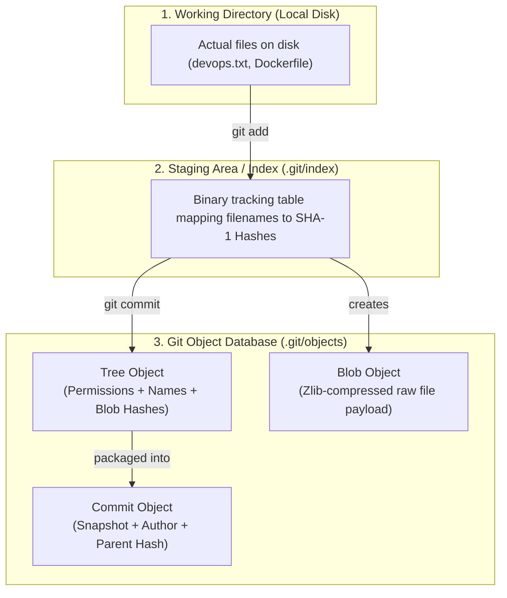
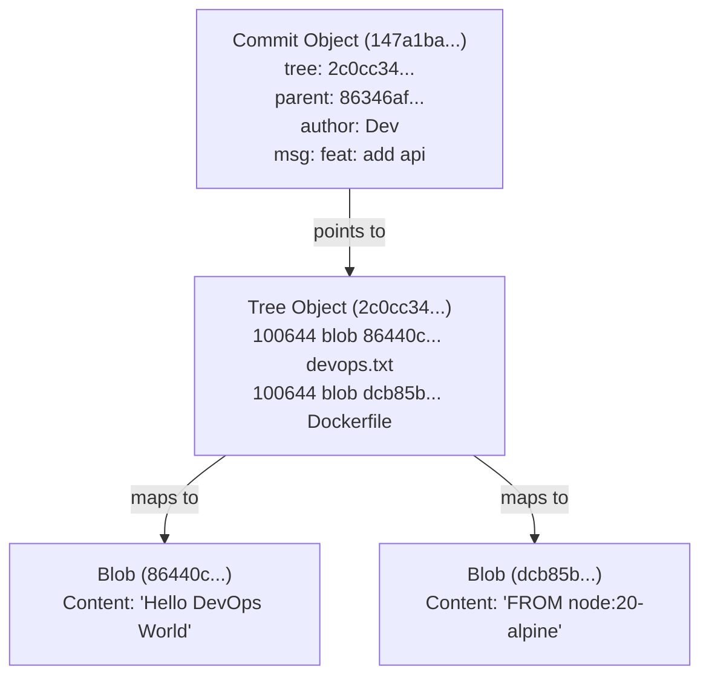
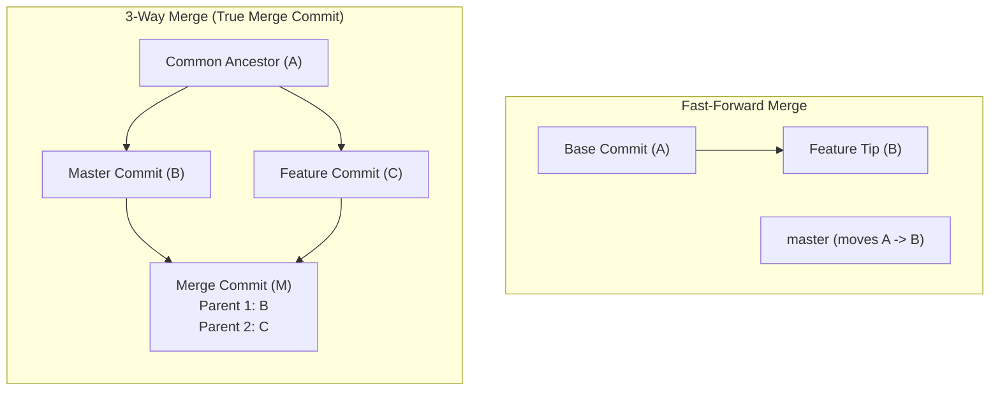
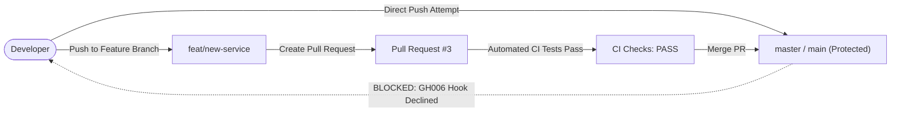

# 13 — Git & GitHub Production Mastery for DevOps Engineers

> **Module:** 13 — Git & GitHub Internals, Team Workflows, and Enterprise Governance  
> **Target Audience:** DevOps Engineers, Cloud Architects, and SREs  
> **Philosophy:** Master both everyday bread-and-butter commands (clone, remote, branch, push, pull, stash) and low-level internals (Objects, Hashes, 3-way merge stages, reflog recovery, interactive rebase, and branch security).

---

## 📑 Table of Contents
1. [Core Mental Model: Git as an Object Database](#1-core-mental-model-git-as-an-object-database)
2. [The 4 Fundamental Git Objects](#2-the-4-fundamental-git-objects)
3. [Plumbing Commands: Inspecting Git's Brain](#3-plumbing-commands-inspecting-gits-brain)
4. [Branching & HEAD Internals](#4-branching--head-internals)
5. [The Daily Bread & Butter: Repositories, Remotes, Branches & Sync](#5-the-daily-bread--butter-repositories-remotes-branches--sync)
6. [Stashing: Saving Work Without Committing](#6-stashing-saving-work-without-committing)
7. [Inspecting & Discarding Changes](#7-inspecting--discarding-changes)
8. [Merging Architecture: Fast-Forward vs 3-Way Merge](#8-merging-architecture-fast-forward-vs-3-way-merge)
9. [Merge Conflicts & The 3-Stage Index](#9-merge-conflicts--the-3-stage-index)
10. [Enterprise Conflict Resolution Strategies](#10-enterprise-conflict-resolution-strategies)
11. [Disaster Recovery: The Git Time Machine (`git reflog`)](#11-disaster-recovery-the-git-time-machine-git-reflog)
12. [Commit Hygiene & Interactive Rebase (`git rebase -i`)](#12-commit-hygiene--interactive-rebase-git-rebase--i)
13. [Hotfix Surgery: Precise Commit Slicing (`git cherry-pick`)](#13-hotfix-surgery-precise-commit-slicing-git-cherry-pick)
14. [Semantic Versioning & Annotated Tags](#14-semantic-versioning--annotated-tags)
15. [Secret Hygiene & Emergency Leak Protocol](#15-secret-hygiene--emergency-leak-protocol)
16. [Enterprise Governance: Branch Protection Rules](#16-enterprise-governance-branch-protection-rules)
17. [GitHub CLI (`gh`) Automation Toolbelt](#17-github-cli-gh-automation-toolbelt)
18. [Master DevOps Git Command Quick-Reference](#18-master-devops-git-command-quick-reference)

---

## 1. Core Mental Model: Git as an Object Database

Git is **not** a traditional file-tracking system or delta-differential tracker.  
Git is a **Content-Addressable Key-Value Object Store** with a VCS (Version Control System) interface layered on top.



### The 40-Character SHA-1 Checksum
Every single piece of data in Git is hashed using SHA-1 (or SHA-256 in newer versions):
- Git takes the object type, size, a null byte, and the content.
- Generates a 40-character hexadecimal string (e.g., `86440c133ff1baa99089c8b401acc1e628b39c83`).
- The **first 2 characters** become the subdirectory name in `.git/objects/86/`.
- The **remaining 38 characters** become the filename `440c133ff1baa99089c8b401acc1e628b39c83`.

---

## 2. The 4 Fundamental Git Objects

Everything inside `.git/objects/` belongs to one of these four immutable types:

| Object Type | Purpose | Contains Filename? | Key Attributes |
| :--- | :--- | :---: | :--- |
| **`blob`** | Stores raw file data / payload. | ❌ No | Zlib compressed, pure file content. |
| **`tree`** | Represents a directory/folder. | ✅ Yes | File mode (100644/100755), blob SHA, filename. |
| **`commit`** | Snapshot of the repository at a point in time. | ❌ No | Top-level tree SHA, parent commit SHA(s), author, timestamp, message. |
| **`tag`** | Permanent release marker pointing to a commit. | ❌ No | Target commit SHA, tagger, release notes, GPG signature. |



---

## 3. Plumbing Commands: Inspecting Git's Brain

Standard user-facing commands (`add`, `commit`, `checkout`, `merge`) are known as **Porcelain Commands**.  
Low-level commands that directly query or manipulate the `.git` database are known as **Plumbing Commands**.

### A. Discovering Raw Objects on Disk
```bash
# List all object files currently stored in the Git database
find .git/objects -type f
```
> **Explanation:** `-type f` ensures Linux lists only actual regular object files, filtering out directory trees (`pack`, `info`).

### B. Inspecting Object Type (`-t`)
```bash
git cat-file -t <hash>
# Example: git cat-file -t 86440c1
# Output: blob
```

### C. Pretty-Printing Object Content (`-p`)
```bash
git cat-file -p <hash>
# Example on a Tree object:
# 100644 blob 86440c133ff1baa99089c8b401acc1e628b39c83    devops.txt
```

### D. Inspecting the Staging Area / Index
```bash
git ls-files
git ls-files -s  # Shows file mode, SHA-1 blob hash, stage number, and filename
```

---

## 4. Branching & HEAD Internals

### What is a Branch?
In Git, a branch is **not** a copy of your codebase. It is literally a **41-byte plain-text file** located at:
```text
.git/refs/heads/<branch-name>
```
Inside this file is nothing more than the **40-character SHA-1 commit hash** that the branch currently points to.

### What is HEAD?
`HEAD` is a symbolic pointer that tells Git which branch you are currently working on:
```bash
cat .git/HEAD
# Output: ref: refs/heads/master
```
When you run `git switch <branch>`, Git simply rewrites that single line in `.git/HEAD`.

### What is a "Detached HEAD"?
If you checkout a commit directly (`git checkout <commit-hash>`) instead of a branch name:
- `cat .git/HEAD` will contain the raw commit hash instead of `ref: refs/heads/...`.
- Any new commits made in this state are orphaned and will eventually be cleaned up by Git Garbage Collection (`git gc`) unless saved to a branch.

---

## 5. The Daily Bread & Butter: Repositories, Remotes, Branches & Sync

This section covers the commands DevOps engineers use 90% of the time in daily operations.

### A. Initializing & Cloning Repositories
```bash
# Initialize a brand-new Git repository in the current folder
git init

# Clone an existing remote repository (HTTPS or SSH)
git clone https://github.com/USERNAME/REPO.git
git clone git@github.com:USERNAME/REPO.git

# Clone into a specific folder name
git clone https://github.com/USERNAME/REPO.git my-folder-name

# Shallow Clone (DevOps CI/CD Optimization): Download ONLY the latest commit (super fast, saves bandwidth)
git clone --depth 1 https://github.com/USERNAME/REPO.git
```

### B. Managing Remotes (`origin`)
The term `origin` is simply the default nickname Git assigns to the remote repository URL.

```bash
# View all currently configured remotes with their URLs
git remote -v

# Link a local repository to a remote GitHub repository
git remote add origin https://github.com/USERNAME/REPO.git

# Change the remote URL (e.g., switched from HTTPS to SSH, or repo renamed)
git remote set-url origin git@github.com:USERNAME/REPO.git

# Remove a remote
git remote remove origin

# Rename a remote
git remote rename origin upstream
```

### C. Everyday Branching Operations
```bash
# List local branches
git branch

# List ALL branches (both local AND remote tracking branches)
git branch -a

# List remote branches only
git branch -r

# Modern syntax: Create and switch to a new branch in one command
git switch -c feat/user-auth
# Traditional equivalent:
git checkout -b feat/user-auth

# Switch between existing branches
git switch master
git switch feat/user-auth

# Switch back to the previous branch you were on (Quick toggle shortcut!)
git switch -

# Delete a local branch safely (prevents deletion if unmerged commits exist)
git branch -d feat/old-feature

# Force delete a local branch (discards unmerged commits)
git branch -D feat/abandoned-feature

# Delete a remote branch from GitHub
git push origin --delete feat/merged-feature
```

### D. Syncing Code: Fetch vs. Pull vs. Push
Understanding the critical difference between `fetch` and `pull` prevents unexpected merge conflicts:

```bash
# 1. Fetch: Downloads new commits, branches, and tags from remote WITHOUT touching your local files
git fetch origin

# 2. Pull: Downloads remote changes AND immediately attempts to merge them into your current branch
git pull origin master

# 3. Pull with Rebase (DevOps Gold Standard):
# Re-applies your local commits ON TOP of the updated remote history, avoiding ugly merge bubbles!
git pull origin master --rebase

# 4. Push: Uploads local branch commits to the remote repository
git push origin feat/user-auth

# 5. Push with Upstream Tracking (-u):
# Links local branch to remote. After doing this once, you can just type 'git push' or 'git pull'!
git push -u origin feat/user-auth

# 6. Push all local branches at once
git push origin --all

# 7. Push all tags at once
git push origin --tags
```

---

## 6. Stashing: Saving Work Without Committing

When working on a feature and an urgent production hotfix arrives, you cannot switch branches with half-written uncommitted code. `git stash` temporarily shelves your dirty working tree.

```bash
# Stash all modified tracked files into a temporary clipboard
git stash

# Stash with a descriptive name
git stash save "wip: halfway through mongodb connection string"

# Stash including untracked (newly created) files (-u)
git stash -u

# View list of all saved stashes
git stash list

# Re-apply the most recent stash AND remove it from stash list
git stash pop

# Re-apply stash but KEEP it in the stash list for reuse
git stash apply

# Apply a specific older stash from the list
git stash apply stash@{2}

# Clear all stashes permanently
git stash clear
```

---

## 7. Inspecting & Discarding Changes

```bash
# Compact, 2-letter status view (clean and fast)
git status -s

# View unstaged line-by-line differences in your working directory
git diff

# View staged differences (changes added to index via 'git add' but not yet committed)
git diff --staged

# View differences between two branches
git diff master..feat/user-auth

# Discard changes to a file in working tree (reverts to last committed state)
git restore file.txt

# Unstage a file (moves file from Staging area back to Working tree without losing edits)
git restore --staged file.txt

# Discard all unstaged changes across the entire project
git restore .
```

---

## 8. Merging Architecture: Fast-Forward vs 3-Way Merge



### 1. Fast-Forward Merge
- Occurs when the target branch (`master`) has had **no new commits** since the feature branch diverged.
- Git does not create a new merge commit.
- It simply slides the pointer in `.git/refs/heads/master` forward to the feature branch's latest commit hash.

### 2. 3-Way Merge (The 'ort' Strategy)
- Occurs when both `master` and `feature` branches have moved forward with independent commits.
- Git evaluates three points:
  1. **Common Ancestor** (Base)
  2. **Current Target Tip** (`ours` / HEAD)
  3. **Incoming Feature Tip** (`theirs` / MERGE_HEAD)
- Generates a **Merge Commit** containing **TWO PARENT POINTERS**:
  ```text
  parent 86346afa2beaaae1319e13fd3f027642d0bd1972  (Parent 1: Master)
  parent 535c3868526fcc8561cf6b16cb2939d3eab65631  (Parent 2: Feature)
  ```

---

## 9. Merge Conflicts & The 3-Stage Index

A merge conflict occurs **strictly** when both branches modify the **exact same lines of the exact same file** since their common ancestor.

### Conflict Markers Explained
```text
<<<<<<< HEAD
DATABASE_PORT=28000
=======
DATABASE_PORT=27019
>>>>>>> conflict-test
```
- `<<<<<<< HEAD`: The code existing on your current branch.
- `=======`: The boundary separator.
- `>>>>>>> <branch>`: The incoming code attempting to merge.

### The 3 Stages of an Unmerged File (`git ls-files -u`)
During a conflict, Git stores three separate versions in `.git/index`:
- **Stage 1 (Base):** The file state at the common ancestor before the branches diverged.
- **Stage 2 (Ours):** The file state on the current branch (`HEAD`).
- **Stage 3 (Theirs):** The file state on the incoming branch (`MERGE_HEAD`).

```bash
git ls-files -u
# Shows:
# 100644 2528345... 1    config.env  (Ancestor)
# 100644 716c32e... 2    config.env  (Ours)
# 100644 047b2df... 3    config.env  (Theirs)
```

### The Resolution Signal: `git add`
Simply editing the file in the working directory does not resolve the conflict.  
Running **`git add <file>`** is the mandatory operational signal that wipes Stages 1, 2, and 3 from `.git/index` and commits the resolved file as **Stage 0**.

---

## 10. Enterprise Conflict Resolution Strategies

In multi-thousand-line enterprise codebases, manual terminal editing is impractical. Use these industry-standard methods:

### Strategy 1: The Golden DevOps Rule (Merge Main into Feat First)
Never merge directly into `main` when conflicts exist.
```bash
# 1. Switch to your feature branch
git switch feat/my-feature

# 2. Pull or merge main into your feature branch
git merge main

# 3. Resolve conflicts, run unit tests, and build Docker image safely
# 4. Once verified, merge feat into main with ZERO conflicts on main
git switch main
git merge feat/my-feature
```

### Strategy 2: Automated Override Flags (`-X theirs` / `-X ours`)
When you know incoming feature code must unconditionally overwrite the legacy version:
```bash
# Accept all incoming changes from feature branch automatically:
git merge -X theirs feat/my-feature

# Checkout single file directly from incoming branch:
git checkout --theirs path/to/large-file.js
git add path/to/large-file.js
```

### Strategy 3: VS Code 3-Way Merge Editor
Click **"Resolve in Merge Editor"** at the bottom right of VS Code to inspect:
- Left pane: Incoming changes
- Right pane: Current changes
- Bottom pane: Live compiled result with 1-click accept buttons

---

## 11. Disaster Recovery: The Git Time Machine (`git reflog`)

> **DevOps Law:** Once a commit is created in Git, it is almost impossible to lose unless explicitly garbage collected (`git gc --prune=now`).

Even if a developer executes a destructive command:
```bash
git reset --hard HEAD~5  # Wipes 5 commits and all local working tree changes
```

### The Recovery Protocol
```bash
# 1. Inspect the Flight Recorder (Reflog tracks EVERY movement of HEAD)
git reflog

# Output example:
# a1b2c3d HEAD@{0}: reset: moving to HEAD~5
# 9f8e7d6 HEAD@{1}: commit: feat(security): add secret keys

# 2. Time-travel directly back to the commit before the accidental reset:
git reset --hard HEAD@{1}
# OR: git reset --hard 9f8e7d6
```
**Result:** The lost commits, files, and history are restored immediately.

---

## 12. Commit Hygiene & Interactive Rebase (`git rebase -i`)

Dirty commit histories (`wip`, `fix typo`, `tested again`) clutter Git history and trigger confusing GitOps rollbacks.

```text
DIRTY HISTORY:
* 31a3eba fix typo
* 9265796 added logout
* 769063d wip login

CLEAN HISTORY (AFTER SQUASH):
* 2e8a1de feat(auth): implement complete user authentication flow
```

### Interactive Rebase Workflow
```bash
# Open the last 3 commits in interactive mode:
git rebase -i HEAD~3
```

In the editor:
- Leave the first line as **`pick`** (anchor commit).
- Change subsequent lines from `pick` to **`s`** (`squash`) or **`f`** (`fixup` — discards commit message).
```text
pick 769063d wip login
s 9265796 added logout
s 31a3eba fix typo
```
- Save and exit. In the next prompt, enter a clean, semantic commit message.

### Safe Abort
If an interactive rebase runs into unexpected conflicts:
```bash
git rebase --abort
```
Returns your repository to the exact clean state prior to running rebase.

### Amending the Latest Commit
To modify the message or include missed files without creating a new commit:
```bash
git commit --amend -m "feat(auth): new updated message"
```

---

## 13. Hotfix Surgery: Precise Commit Slicing (`git cherry-pick`)

When a critical bug fix commit is buried inside an unmerged, work-in-progress feature branch:

```text
feature-branch:
  Commit A -> Commit B (CRITICAL HOTFIX) -> Commit C (broken) -> Commit D (broken)
```

```bash
# 1. Locate the exact commit hash
git log feature-branch --oneline

# 2. Switch to target production branch
git switch master

# 3. Pluck ONLY that single commit and apply it to master:
git cherry-pick <commit-hash-of-B>

# Optional: Apply changes without making a commit (for review):
git cherry-pick -n <commit-hash>
```

---

## 14. Semantic Versioning & Annotated Tags

### Semantic Versioning (SemVer) Standard: `vMAJOR.MINOR.PATCH`
- **PATCH (`v1.0.0` ➡️ `v1.0.1`):** Backward-compatible bug/security fixes.
- **MINOR (`v1.0.1` ➡️ `v1.1.0`):** New backward-compatible functionality.
- **MAJOR (`v1.1.0` ➡️ `v2.0.0`):** Incompatible API / breaking changes.

### Creating Production Annotated Tags
Annotated tags store the tagger, date, message, and cryptographic signature:
```bash
# Create annotated tag
git tag -a v1.0.0 -m "Release v1.0.0: Initial production launch"

# Push tags to remote (triggers automated CI/CD Docker image release)
git push origin --tags

# Inspect tag metadata
git show v1.0.0
```

---

## 15. Secret Hygiene & Emergency Leak Protocol

### Removing Tracked Files Safely (`git rm --cached`)
If a file was added to `.gitignore` after being tracked, Git continues tracking it.
```bash
# Stops tracking file while PRESERVING it on your local disk:
git rm --cached .env
git commit -m "security: untrack .env file"
```

### 🚨 Emergency SOP: If Secrets are Pushed to GitHub
1. **P0 Action — REVOKE / ROTATE IMMEDIATELY:**  
   Automated scrapers index GitHub in seconds. The secret must be treated as compromised. Deactivate AWS keys, rotate database passwords, and reissue tokens immediately.
2. **Purge Commit from History (Recent Commit):**
   ```bash
   git reset --hard HEAD~1
   git push origin <branch> --force
   ```
3. **Purge Across Deep History (`git-filter-repo`):**
   ```bash
   git filter-repo --invert-paths --path .env
   git push origin --force --all
   git push origin --force --tags
   ```
4. **Enable GitHub Push Protection:**  
   GitHub Repo ➡️ Settings ➡️ Code security ➡️ Enable **Secret Scanning Push Protection**.

---

## 16. Enterprise Governance: Branch Protection Rules

In enterprise production environments, direct pushes to `main` or `master` are strictly prohibited.



### Essential Production Protection Settings
- ✅ **Require a pull request before merging:** Blocks direct CLI pushes.
- ✅ **Require status checks to pass before merging:** Blocks merge until automated GitHub Actions pass.
- ✅ **Require approvals:** Requires peer code reviews (keep unchecked for solo sandbox testing).
- ✅ **Block force pushes:** Prevents destructive `--force` history rewrites.
- ✅ **Restrict deletions:** Prevents accidental branch deletion.

---

## 17. GitHub CLI (`gh`) Automation Toolbelt

DevOps engineers manage GitHub directly from the terminal without context-switching to a web browser.

### Authentication & Remote Binding
```bash
# Authenticate CLI with browser or token
gh auth login

# Create a remote repository from local directory and push immediately
gh repo create my-repo --public --source=. --remote=origin --push
```

### Pull Request Lifecycle via CLI
```bash
# 1. Create a Pull Request
gh pr create --title "feat(api): add express api service" --body "Detailed PR notes"

# 2. View Open PRs and Status
gh pr list
gh pr status

# 3. View Diffs of a PR
gh pr diff <pr-number>

# 4. Merge PR (Squash and delete branch automatically)
gh pr merge --squash --delete-branch

# 5. Emergency Admin Override Merge
gh pr merge --squash --delete-branch --admin
```

---

## 18. Master DevOps Git Command Quick-Reference

| Operational Need | Command |
| :--- | :--- |
| **Clone repo** | `git clone <url>` |
| **Fast CI/CD shallow clone** | `git clone --depth 1 <url>` |
| **View remote URLs** | `git remote -v` |
| **Add remote origin** | `git remote add origin <url>` |
| **Update remote origin URL** | `git remote set-url origin <url>` |
| **Create & switch branch** | `git switch -c <branch>` *(or `git checkout -b <branch>`)* |
| **Switch branch** | `git switch <branch>` |
| **Delete local branch** | `git branch -d <branch>` |
| **Force delete local branch** | `git branch -D <branch>` |
| **Delete remote branch** | `git push origin --delete <branch>` |
| **Save dirty work to stash** | `git stash -u` |
| **Restore and drop stash** | `git stash pop` |
| **Download remote changes only** | `git fetch origin` |
| **Pull & merge remote changes** | `git pull origin <branch>` |
| **Pull with rebase (Clean)** | `git pull origin <branch> --rebase` |
| **Push with upstream tracking** | `git push -u origin <branch>` |
| **Inspect status (compact)** | `git status -s` |
| **Inspect unstaged diff** | `git diff` |
| **Inspect staged diff** | `git diff --staged` |
| **Discard unstaged file change** | `git restore <file>` |
| **Unstage file** | `git restore --staged <file>` |
| **Inspect raw object type** | `git cat-file -t <hash>` |
| **Pretty-print object content** | `git cat-file -p <hash>` |
| **Inspect staged files & SHAs** | `git ls-files -s` |
| **Inspect unmerged conflict stages** | `git ls-files -u` |
| **Graph-based visual log** | `git log --oneline --graph --all` |
| **View entire action history** | `git reflog` |
| **Undo hard reset disaster** | `git reset --hard HEAD@{n}` |
| **Squash last N commits** | `git rebase -i HEAD~N` |
| **Abort failing rebase** | `git rebase --abort` |
| **Amend commit message** | `git commit --amend -m "new message"` |
| **Pluck single commit** | `git cherry-pick <hash>` |
| **Untrack file without deleting** | `git rm --cached <file>` |
| **Create annotated release tag** | `git tag -a v1.0.0 -m "Release notes"` |
| **Push all branches & tags** | `git push origin --all && git push origin --tags` |
| **CLI PR creation** | `gh pr create --title "..." --body "..."` |
| **CLI PR squash & merge** | `gh pr merge --squash --delete-branch` |
| **Purge file from history** | `git filter-repo --invert-paths --path <file>` |
