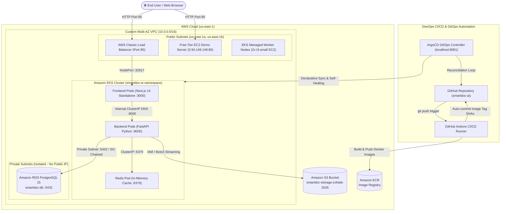

# Cloud & DevOps Engineering: Zero to Production Master Playbook

> A production-grade handbook, cheatsheet, and architectural blueprint covering Linux, Docker, AWS Core Cloud Services, Kubernetes, GitOps with ArgoCD, and CI/CD Automation.

---

## 📌 Table of Contents

| Module | Title | Core Focus & Topics Covered |
| :--- | :--- | :--- |
| **[01](01-linux-ubuntu/README.md)** | **[Linux & Ubuntu Production Administration](01-linux-ubuntu/README.md)** | User management, permissions, systemd, journalctl, swap setup, storage, ufw, SSH keys. |
| **[02](02-docker-containerization/README.md)** | **[Docker & Multi-Stage Containerization](02-docker-containerization/README.md)** | Dockerfile best practices, multi-stage builds, networks, volumes, Docker Compose profiles. |
| **[03](03-aws-core-networking-vpc/README.md)** | **[AWS Core Cloud Networking & VPC](03-aws-core-networking-vpc/README.md)** | VPC, CIDR, Public vs Private Subnets, IGW, Route Tables, NAT, Multi-AZ High Availability. |
| **[04](04-aws-compute-ec2/README.md)** | **[AWS EC2 & Zero-Trust Security Group Chaining](04-aws-compute-ec2/README.md)** | Provisioning instances, SSH keys, Nginx reverse proxy, SG Chaining (No public CIDRs). |
| **[05](05-aws-database-rds/README.md)** | **[Amazon RDS PostgreSQL Architecture](05-aws-database-rds/README.md)** | DB Subnet Groups, Private Subnet isolation, parameter groups, backups, migrations, connections. |
| **[06](06-aws-storage-s3/README.md)** | **[Amazon S3 Object Storage](06-aws-storage-s3/README.md)** | S3 buckets, CLI commands, Python Boto3 streaming, lifecycle rules, bucket policies, encryption. |
| **[07](07-aws-registry-ecr/README.md)** | **[Amazon ECR Container Registry](07-aws-registry-ecr/README.md)** | Private registries, docker login with AWS CLI, image tagging with Git SHA, push/pull. |
| **[08](08-kubernetes-fundamentals/README.md)** | **[Kubernetes Core Operations & kubectl](08-kubernetes-fundamentals/README.md)** | Pods, Deployments, Services (ClusterIP, NodePort, LoadBalancer), ConfigMaps, Secrets, Probes. |
| **[09](09-aws-eks-production/README.md)** | **[Amazon EKS Production Deployment](09-aws-eks-production/README.md)** | `eksctl`, Managed NodeGroups, CoreDNS, Classic ELB, AWS Load Balancer Controller, cost teardown. |
| **[10](10-gitops-argocd/README.md)** | **[GitOps Continuous Delivery with ArgoCD](10-gitops-argocd/README.md)** | Declarative CD, ArgoCD CRD, Auto-sync, Self-healing, initial admin secret, port-forwarding. |
| **[11](11-cicd-github-actions/README.md)** | **[GitHub Actions CI/CD Automation](11-cicd-github-actions/README.md)** | Multi-tier pipelines, GitHub Secrets, ECR push, auto-committing manifest tags to git repo. |
| **[12](12-production-troubleshooting/README.md)** | **[Production Troubleshooting & War Stories](12-production-troubleshooting/README.md)** | Next.js standalone DNS rewrites, shallow probes, CrashLoopBackOff, CoreDNS split-horizon. |

---

## 🏛️ High-Level Production Architecture

---

## 🏷️ Terminal Command Tagging Standard

To prevent environment confusion, commands across all chapters are explicitly labeled with one of the following tags:

- 💻 **`[Local Laptop Terminal]`** — Commands executed on your local development machine (macOS / Linux / Windows WSL).
- ☁️ **`[Ubuntu EC2 / Cloud VM Terminal]`** — Commands executed directly on a remote Ubuntu cloud server via SSH.
- ☸️ **`[Kubernetes / EKS Terminal]`** — Cluster orchestration commands executed using `kubectl` or `eksctl`.

---

## 🚀 How to Use This Playbook

1. **For Beginners:** Follow the modules sequentially from `01` to `12`.
2. **For Cloud Deployments:** Jump directly to `03-aws-core-networking-vpc` through `09-aws-eks-production`.
3. **For Job Interviews:** Review `12-production-troubleshooting` and the architecture sections in each chapter for battle-tested talking points.
